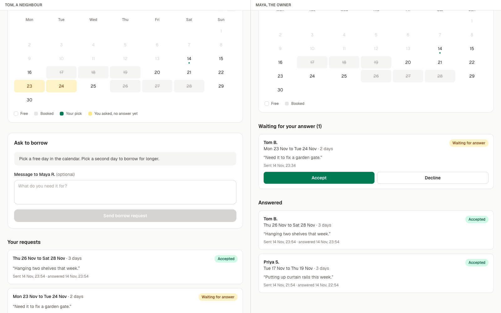

# Borrow request flow

A neighbour picks dates on an item's availability calendar and sends a borrow
request. The owner accepts or declines, and the requester sees the status change
live, without refreshing.

Built with Next.js (App Router), tRPC, MongoDB and TypeScript. Live updates use
tRPC subscriptions over WebSockets.



## Run it

```bash
npm install && npm run dev
```

Then open <http://localhost:3000>. Needs Node.js 22 or newer.

There is no database to set up. Without `MONGODB_URI`, the API starts an
in-memory MongoDB and seeds it with three neighbours, one item, one accepted
borrow and one pending request. The first start downloads a MongoDB binary, which
can take a minute. Data resets when the API restarts.

## Try the flow

The quickest look is <http://localhost:3000/demo>, which shows the neighbour and
the owner next to each other in one window.

Or open two browser windows side by side:

| Window | URL | Who |
| --- | --- | --- |
| 1 | <http://localhost:3000/?as=user-tom> | Tom, a neighbour |
| 2 | <http://localhost:3000/?as=user-maya> | Maya, who owns the drill |

1. As Tom, pick a first and a last day in the calendar and send the request.
2. Maya's window shows the request straight away under "Waiting for your answer".
3. As Maya, accept or decline.
4. Tom's window changes the status by itself, and the days turn booked in every
   open calendar.

A third window as `?as=user-priya` shows what a neighbour who is not part of the
request sees: only the calendar changes.

To see the overlap rule, send requests for the same days as Tom and as Priya,
then accept one as Maya. The other is closed automatically and says why.

## How it fits together

```
Browser ── HTTP  /api/trpc ──▶ Next.js (3000) ── proxy ──▶ tRPC API (3001) ──▶ MongoDB
   └────── WebSocket ─────────────────────────────────────▶ tRPC API (3001)
```

Two processes start with `npm run dev`:

- **Next.js** on port 3000 serves the page and forwards `/api/trpc/*` to the API.
- **The tRPC API** on port 3001 answers queries and mutations over HTTP and
  subscriptions over WebSocket. Both live in one process, so a mutation can
  notify open subscriptions directly.

```
src/
  domain/        Business rules as pure functions. No database, no framework.
    dates.ts       Calendar days as YYYY-MM-DD strings
    borrow.ts      Who may request, who may answer, what overlaps
    selection.ts   What a click on a calendar day does
  server/
    db.ts            MongoDB connection, document types, indexes
    borrow-service.ts  Use cases: send a request, answer a request
    events.ts        In-process publish/subscribe for live updates
    routers/app.ts   The tRPC router (queries, mutations, subscription)
    trpc.ts          Context, error mapping, "who is calling" middleware
    seed.ts          Seed users, item and requests
    index.ts         Starts the HTTP + WebSocket server
  trpc/client.tsx  tRPC + React Query client (HTTP link and WebSocket link)
  components/      Calendar, request cards, neighbour view, owner view
  app/             Next.js layout, the item page and the side-by-side /demo page
docs/spec.md     The written spec the feature was built from
```

## Decisions worth knowing about

**Double booking is prevented by the database, not only by code.** Accepting a
request inserts one `bookedDays` document per day with the id `itemId:day`.
MongoDB's unique `_id` index rejects a second booking for the same day, so two
simultaneous accepts cannot both win. A test fires two overlapping accepts at
once and checks that exactly one succeeds.

**Status changes are atomic.** A request moves out of `pending` with
`findOneAndUpdate({ _id, status: "pending" })`, so it can only be answered once
even if two answers race.

**Days are strings.** A borrow is about whole days, so days travel as
`YYYY-MM-DD` from the database to the calendar. Nothing converts them to
timestamps, which removes time zone bugs from range comparisons.

**Live updates do not leak.** The requester and the owner receive the full
request. Everyone else only receives "availability changed" and refetches the
calendar.

**Rules live in one place.** `src/domain` has no imports from MongoDB, tRPC or
React. The API maps each broken rule to an error code, and the UI shows the
rule's message.

## Guardrails

```bash
npm run check   # lint, type check and all tests
```

- **Types end to end.** Strict TypeScript, zod validation on every input, and
  the client's types are inferred from the router, so a changed API breaks the
  build instead of the page.
- **Unit tests** cover the rules: date math, overlaps, the limits, who may do
  what, and calendar selection.
- **Integration tests** run the real router against an in-memory MongoDB: the
  whole flow, permissions, automatic declines, the double-booking race, and who
  receives which live update.
- **CI** (`.github/workflows/ci.yml`) runs lint, type check, tests and a
  production build on every push, plus a Docker Compose smoke test.
- **A written spec** (`docs/spec.md`) states the rules in plain language. Tests
  are named after it.

## Running against a real MongoDB

```bash
docker compose up --build
```

This starts MongoDB with a persistent volume and the app on the same ports. Or
point the dev setup at any MongoDB:

```bash
MONGODB_URI=mongodb://localhost:27017 npm run dev
```

Other settings are listed in `.env.example`.

## Limits of this version

- **No real login.** The browser says who it is with `?as=<user id>` and the API
  trusts it. Every permission check is already in place behind that, so adding
  sessions means changing only how `userId` reaches the context in
  `src/server/trpc.ts`.
- **One API instance.** The event bus is in memory. With several instances it
  would be replaced by Redis pub/sub or MongoDB change streams behind the same
  `publish` / `subscribe` methods in `src/server/events.ts`.
- **"Today" is the UTC day.** Around midnight a neighbour far from UTC may see
  today as bookable a few hours early or late.
- **One item.** The data model and the API take an `itemId` everywhere, but the
  page shows the single seeded item.
